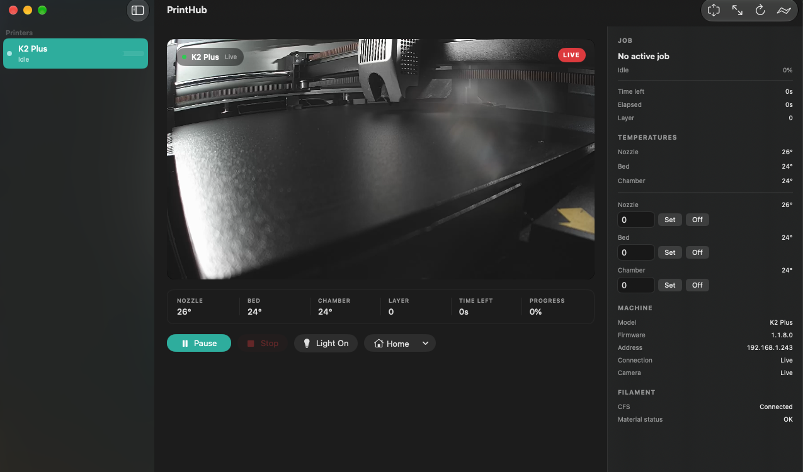
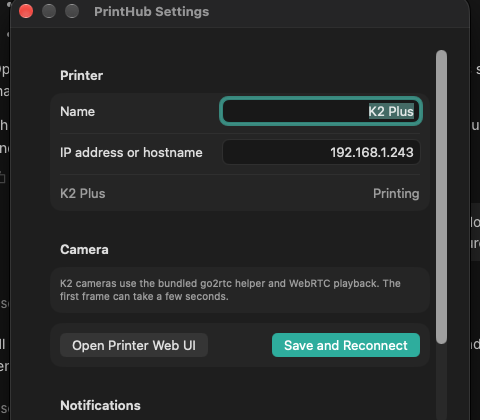

# PrintHub

A native macOS control room for Creality 3D printers.



PrintHub watches your printers on the local network, shows their cameras, and lets you
pause, resume, stop, set temperatures, and home the machine — without a Creality Cloud
account.

Built first for the **K2 Plus** and **K1 Max**, with a model-driven design intended to
cover most Creality OS / Klipper-based printers.

## Install

Download the latest DMG from the
[releases page](https://github.com/frankt2012/PrintHub/releases/latest), or install with
Homebrew:

```sh
brew tap frankt2012/printhub
brew trust frankt2012/printhub
brew install --cask printhub
```

PrintHub requires **macOS 14 Sonoma or later**.

The current build is ad-hoc signed and not notarized. If macOS blocks the first launch,
right-click **PrintHub** in Applications and choose **Open**, or allow it under
**System Settings → Privacy & Security**.

## Features

- **Live camera** for K2 printers through a bundled go2rtc helper and WebRTC
- **Live telemetry**: state, progress, layers, time remaining, nozzle/bed/chamber
  temperatures, CFS presence and material status
- **Safe controls**: pause/resume, stop with confirmation, light, nozzle/bed/chamber
  targets, and Home X / Y / Z / All
- **Focus Camera** and **Full Screen** modes
- **Multi-printer sidebar** with persistent entries and Add Printer
- **Menu bar extra** with status, temperatures, time remaining, and quick actions
- **Notifications** for print complete, error, and paused
- Local-only: no account and no cloud dependency



## Requirements

- macOS 14 or later
- A Creality K2 or K1-series printer on the same local network
- Local Network permission on first launch
- Notification permission if you want print alerts

## Notes and limitations

- K2 cameras use go2rtc and a WKWebView camera surface. Native MJPEG for K1-family
  printers is the next camera path.
- Starting prints, G-code upload, CFS material changes, and timelapse browsing are not
  in this release.
- PrintHub is an independent project. It is not affiliated with Creality.
- The printer API is local and unauthenticated. Keep printers on a trusted network; use a
  VPN such as Tailscale for remote access, never a forwarded port.

## Build from source

Requirements: Xcode 16+, XcodeGen, and macOS 14+.

```sh
./scripts/build-app.sh --run
```

To produce a release DMG:

```sh
./scripts/release.sh 0.1.0
```

The DMG is written to `dist/`. The app and bundled go2rtc helper are ad-hoc signed.

## Project layout

- `PrintHub/` — the SwiftUI app
- `Packages/PrintHubKit/` — printer protocol, telemetry, and WebSocket client
- `Packages/PrintHubSpike/` — Phase 0 protocol and camera harness
- `Casks/printhub.rb` — Homebrew cask
- `docs/` — design, protocol, results, and screenshots

## License

MIT — see [LICENSE](LICENSE). Not affiliated with Creality.
