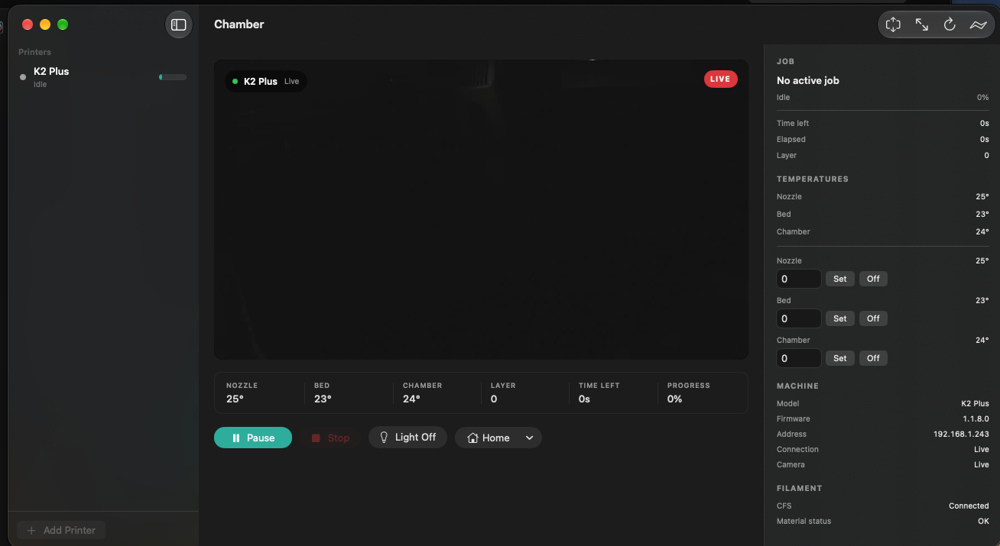

# Chamber

A native macOS control room for Creality 3D printers.

> **Status: Phase 0 complete, first native app slice running.** The app connects to a
> K2 Plus on firmware 1.1.8.0, shows live telemetry, and plays the camera through the
> bundled go2rtc helper.



Chamber watches the printers on your local network, shows their cameras, and lets you
pause, resume, stop, and adjust the things you actually touch during a print — without a
Creality Cloud account.

Built first for the **K2 Plus** and **K1 Max**, with a model-driven architecture intended
to cover most Creality OS / Klipper-based printers.

## Documents

- [PLAN.md](PLAN.md) — product definition, scope, architecture, roadmap, risks.
- [docs/protocol-notes.md](docs/protocol-notes.md) — the local WebSocket, MJPEG, and
  WebRTC details, with implementation hazards.
- [docs/design-brief.md](docs/design-brief.md) — the native Mac UI/UX specification.
- [docs/phase-0-spike.md](docs/phase-0-spike.md) — the camera/protocol spike plan and
  decision scorecard.
- [docs/hardware-test-log.md](docs/hardware-test-log.md) — capture template for
  firmware/protocol testing.
- [docs/devices.md](docs/devices.md) — the printers, firmware, and addresses used for
  development.
- [docs/phase-0-results.md](docs/phase-0-results.md) — real K2 Plus telemetry and camera
  results on firmware 1.1.8.0.
- [docs/decisions/0002-k2-camera-fallback.md](docs/decisions/0002-k2-camera-fallback.md) —
  why v1 uses a bundled go2rtc helper for the K2 camera.
- [Packages/ChamberSpike](Packages/ChamberSpike/README.md) — the working Phase 0 harness.

## Native app

The app lives in `Chamber/` and is generated with XcodeGen. `Packages/ChamberKit` is
the app-facing protocol/codec kit; `Packages/ChamberSpike` is the Phase 0 harness.

Requirements: macOS 14+, Xcode 16+, and [XcodeGen](https://github.com/yonaskolb/XcodeGen).

```sh
./scripts/build-app.sh --run
```

It includes the native sidebar, live go2rtc/WebRTC camera surface, telemetry status strip,
machine inspector, pause/resume/stop/light actions, and a bundled go2rtc helper.

- **Focus Camera** hides the sidebar and inspector; **Full Screen** uses the macOS
  window full-screen mode. The window opens at 1280 × 820.
- **Temperature controls** for nozzle, bed, and chamber with Set/Off, clamped to
  the printer's reported maximums.
- **Home X**, **Home Y**, **Home Z**, and **Home All** use Moonraker `G28` on
  the K2; Home All falls back to Creality's XY-then-Z sequence when Moonraker is
  unavailable. Homing is disabled while a print is active.

The camera is a WKWebView surface for v1; native chrome, controls, and telemetry
remain SwiftUI.
The first launch asks for Local Network access; allow it, and the app will retry
the printer automatically.

## Phase 0 harness

The spike harness is already usable:

```sh
cd Packages/ChamberSpike
swift run chamber-spike discover
swift run chamber-spike probe 192.168.1.50
swift run chamber-spike watch 192.168.1.50 --seconds 60
swift run chamber-spike snapshot 192.168.1.50
swift run chamber-spike mjpeg 192.168.1.50 --seconds 30
```

A local mock printer (`Tools/mock-printer`) exercises the handshake, heartbeat,
telemetry, control commands, and MJPEG without hardware. See the package README
for ports and options.

## The short version

- **v1:** live camera, telemetry, pause/resume/stop, light, temperatures, homing,
  menu bar extra, multi-printer entries, and completion/error/pause notifications.
- **Transport:** `ws://<printer>:9999` with subprotocol `wsslicer`.
- **Cameras:** K2 uses a bundled go2rtc helper and a WKWebView WebRTC surface; K1-family
  MJPEG is the next native path.
- **Privacy:** local network only. Remote access via VPN (e.g. Tailscale), never a
  built-in cloud relay.
- **Not v1:** G-code upload, starting prints, CFS material changes, AI failure detection.

## Current status

Phase 0 is complete. The native app connects to the K2, shows live telemetry and
camera, supports multi-printer entries, menu bar controls, temperature setting, and
individual/all-axis homing.

Next: Add Printer discovery, K1 Max MJPEG support, notification thumbnails, a native
WHEP client to replace the WKWebView camera surface, and a signed/notarized release.

## License

MIT — see [LICENSE](LICENSE). Not affiliated with Creality.
