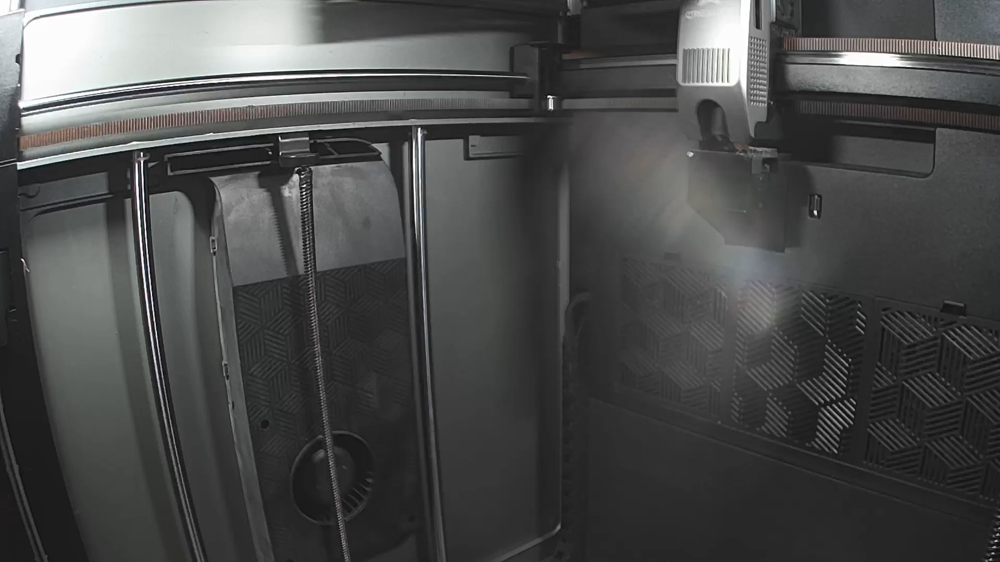

# Phase 0 results — K2 Plus, firmware 1.1.8.0

**Date:** 15 November 2026
**Printer:** Creality K2 Plus (`K2Plus-TEST`)
**Firmware:** 1.1.8.0 (DWIN `CR0CN240110C10`)
**Address:** `192.168.1.50`
**Method:** the OpenCode sandbox could not reach the printer directly, so the user's
Chrome (via the `browse` extension) was used as a network bridge. All protocol and
camera checks below ran inside a page on `192.168.1.50:4408`, with the printer on the
other side of Chrome's real LAN connection.

## 1. Printer API (`ws://192.168.1.50:9999`)

- Handshake succeeded with subprotocol `wsslicer` (HTTP 101).
- First state frame identifies the printer:
  - `model`: `F008`
  - `hostname`: `K2Plus-TEST`
  - `modelVersion`: `printer hw ver:;printer sw ver:;DWIN hw ver:CR0CN240110C10;DWIN sw ver:1.1.8.0;`
  - `webrtcSupport`: `1`
- Idle state: `state: 0`, `printFileName: ""`, `printProgress: 0`, `printLeftTime: 0`.
- Temperatures: nozzle `25.81 °C`, bed `23.43 °C`, chamber `25 °C`; max nozzle `350`,
  max bed `120`, max chamber `60`.
- CFS present: `cfsConnect: 1`, `materialStatus: 0`, `materialDetect: 0`.
- 79 keys in the full state frame; notable extras: `aiDetection`, `aiPausePrint`,
  `video`, `videoElapse`, `videoElapseFrame`, `videoElapseInterval`, `tfCard`,
  `powerLoss`, `curFeedratePct`, `curFlowratePct`, three fan channels.
- `boxsInfo` did not return CFS slot data in this idle session; Moonraker's `box`
  object did (section 3).

### Control command

`{"method":"set","params":{"lightSw":1}}` changed `lightSw` from `0` to `1` and was
reported back in the next state frame. Setting it to `0` restored the original state.
The command path works.

## 2. Camera (`http://192.168.1.50:8000/call/webrtc_local`)

- Offer/answer exchange: HTTP 200, valid answer SDP.
- ICE connected in under a second; video track received.
- Resolution: **1920 × 1080**
- Frame rate: **15 fps**
- 8-second measurement: 120 frames, 0 dropped, 0 corrupt, 0 freezes, 0 packets lost.
- Media time / wall time ratio in Chrome: **0.9999** (no 20× timestamp jump on this
  firmware and path).
- Average frame interval: **66.9 ms**.
- First frame appeared in **0.7–1.0 s** after starting negotiation.
- Required workaround: Chrome advertised mDNS `.local` host candidates; replacing them
  with the Mac's raw LAN address (`192.168.1.222`) before posting the offer is what made
  ICE connect. This matches the known K2/K1C behaviour.
- The native WebRTC framework already advertises raw IPv4 host candidates (verified in
  the mock), so the production client does not need the mDNS rewrite. This must still be
  confirmed on the real printer from a non-sandboxed process.



Captured frames:

- `captures/k2-frame-fw1.1.8.0.jpg` — light off, 1920 × 1080.
- `captures/k2-frame-lit-fw1.1.8.0.jpg` — light on (toggled and restored).
- `captures/k2-camera-stats-fw1.1.8.0.jpg` — frame from the 8-second stats run.
- `captures/k2-webrtc-stats-fw1.1.8.0.json` — measured stats.

## 3. Moonraker (through Fluidd at `:4408`)

Fluidd proxies Moonraker on the same origin. The K2 Plus runs a full Moonraker:

- `GET /server/info` → `klippy_connected: true`, `api_version: 1.0.5`.
- `GET /printer/info` → `hostname: K2Plus-TEST`, Klipper `09faed31-dirty`,
  `state: ready`.
- `GET /printer/objects/list` → 100+ objects, including `box`, `filament_rack`,
  `print_stats`, `virtual_sdcard`, `temperature_sensor chamber_temp`,
  `heater_generic chamber_heater`, `temperature_fan chamber_fan`, `output_pin LED`,
  `fan_feedback`, `box`, `load_ai`.
- `GET /printer/objects/query?box` → CFS state with four slots, materials, colors,
  remaining lengths, RFID data, humidity.
- `GET /printer/objects/query?print_stats&virtual_sdcard&extruder&heater_bed` →
  standby, 0 progress, nozzle/bed temperatures.
- `GET /printer/objects/query?temperature_sensor chamber_temp&heater_generic chamber_heater`
  → chamber `25.2 °C`, target `0`.
- `GET /printer/objects/query?output_pin LED` → LED `0.0`; fans `fan0/1/2` at `0`.

This is a strong secondary source for CFS, print history, and job metadata on K2. It
also means a Moonraker fallback is worth keeping for the K2 family.

### CFS shape (abridged)

```json
{
  "box": {
    "filament": 1,
    "state": "connect",
    "auto_refill": 1,
    "enable": 1,
    "T1": {
      "state": "connect",
      "temperature": "24",
      "dry_and_humidity": "40",
      "remain_len": ["0", "-1", "-1", "-1"],
      "color_value": ["-1", "07a92ac", "0ff1e1e", "0000000"],
      "material_type": ["-1", "000001", "000001", "000001"],
      "type": "CFS",
      "version": "1.5.3"
    },
    "T2": { "state": "None" },
    "T3": { "state": "None" },
    "T4": { "state": "None" }
  }
}
```

The slot/color/material arrays are indexed by sub-slot; the UI must not assume one
material per `T1` object.

## 4. What this changes

- **Camera verdict:** keep native WebRTC as the preferred path. The printer's K2 camera
  is healthy on firmware 1.1.8.0, at 1080p15, with 0 drops in Chrome. The native
  `AVSampleBufferDisplayLayer` renderer still needs a real test from the host.
- **Moonraker is not optional on K2.** It is present and rich. Use WS `:9999` for
  low-latency telemetry and controls, and Moonraker for CFS, history, and job metadata.
- **The `:4408` Fluidd port is useful for diagnostics**, not as the app's API.
- **Sandbox limitation:** the native harness could not reach `192.168.1.50` from this
  OpenCode session (`No route to host`), while Chrome could. The app must be tested from
  a normal macOS process on the printer's LAN.

## 5. Native host run (16 November 2026)

The harness was bundled as an ad-hoc `.app` with `NSLocalNetworkUsageDescription`.
After macOS granted Local Network permission to the bundle:

- Native `probe` succeeded: WebSocket handshake 101, model **K2 Plus (F008)**,
  firmware **1.1.8.0**, hostname `K2Plus-TEST`.
- Native `watch` ran for 60 seconds against `:9999` with live temperatures.
- Native WebRTC signalling succeeded, but **DTLS stalled at `connecting`** and no
  RTP bytes arrived. This reproduced with WebRTC M157 and M139. Details and the
  fallback decision are in
  [`decisions/0002-k2-camera-fallback.md`](decisions/0002-k2-camera-fallback.md).
- go2rtc 1.9.15, launched as a child of the permissioned app bundle, produced a
  valid 1920 × 1080 JPEG snapshot from the same camera.
- go2rtc's **WebRTC page** plays live in Chrome, Safari, and WKWebView at
  1920 × 1080. This is the v1 camera path.
- go2rtc HLS was tested with AVPlayer but produced only two static segments and
  did not stay live, so it is not used.
- go2rtc MJPEG requires ffmpeg and currently fails with missing H.264 PPS, so it
  is not the v1 path.
- go2rtc RTSP/WebRTC listeners are bound to **127.0.0.1**, so there is no macOS
  firewall prompt and no LAN listener.
- The first native app slice is running: K2 telemetry, CFS status, firmware
  1.1.8.0, live camera (go2rtc WebRTC in WKWebView), pause/stop/light controls,
  nozzle/bed/chamber target setters, Home X/Y/Z/All, Focus Camera, and the
  native inspector. See `docs/PrintHub.png`.
- Homing was tested on the real printer: `G28 X` moved X to the K2 park position
  (342.5) while leaving Y at 100; `G28 Y` then moved Y to 3.79 while leaving X;
  `G28 Z` and `G28` returned X/Y/Z to the normal park position. Individual axes
  go through Moonraker `printer/gcode/script`; Creality's `autohome` field only
  handles the combined XY/Z forms reliably.

## 6. Remaining Phase 0 tests

1. Run `printhub-spike probe 192.168.1.50` from a normal Terminal on the LAN.
2. Run `printhub-spike watch 192.168.1.50 --seconds 60` and verify the native reducer
   against a live stream.
3. Run `printhub-spike webrtc 192.168.1.50 --seconds 60` from the bundled app and
   confirm the DTLS failure is reproducible.
4. Measure the WKWebView WebRTC path: first frame, steady-state latency, CPU, and
   memory for one and two printers.
5. Test pause/resume/stop on a real print (with confirmation).
6. Repeat on the K1 Max after repair.

Native command for the host:

```sh
cd "/Volumes/HOME 1TB EXT/Documents/PrintHub/Packages/PrintHubSpike"
./Tools/fetch-webrtc.sh
swift run printhub-spike probe 192.168.1.50
swift run printhub-spike watch 192.168.1.50 --seconds 60 --record captures/k2-live.jsonl
swift run printhub-spike webrtc 192.168.1.50 --seconds 60
```
